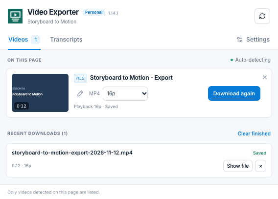

# Video Exporter — Personal Edition

[](https://github.com/m-saad-siddique/video-exporter-personal-edition/actions/workflows/validate.yml)
[](LICENSE)

An open-source Chrome extension for saving browser-accessible videos and exporting transcripts from websites and embedded players.



*Preview uses a synthetic test video.*

## Features

- Video cards with thumbnails, duration, source type, export naming, and per-video quality controls.
- Direct HTML5 video files, unencrypted HLS, and supported Vimeo H.264/AAC DASH streams.
- MP4 remuxing without re-encoding when supported, with video-duration and audio-coverage checks.
- Progress that survives closing and reopening the popup, recent download history, retry, and **Show file**.
- Transcript preview, search, copying, and TXT, SRT, or VTT export.
- Saved error reports with URL query values redacted.

It works on ordinary HTTP/HTTPS pages rather than being limited to one website. Detection does not guarantee support for every provider or media format. Use it for content you own or have permission to download.

## Install

Requires a current version of Google Chrome or a compatible Chromium browser.

1. Download the [source ZIP](https://github.com/m-saad-siddique/video-exporter-personal-edition/archive/refs/heads/main.zip) and extract it, or clone this repository.
2. Open `chrome://extensions` and enable **Developer mode**.
3. Click **Load unpacked** and select the folder containing `manifest.json`.
4. Reload video pages that were already open so they load the extension.
5. Play a video briefly, then open **Video Exporter — Personal Edition**.

Updates to an unpacked installation require reloading the extension in `chrome://extensions` and reloading existing video pages.

## Use

**Videos:** Choose a quality, optionally rename the export, and click **Download**. Exact resolutions appear when stream metadata exposes them; otherwise choices are labeled as resolution limits. Direct files retain their existing quality.

You can close the popup while processing continues. Keep the video tab open until processing finishes. **Saved** appears after Chrome confirms file-save completion. **Show file** reveals the download in its folder. History keeps the last 30 entries for the current browser session; clearing it does not delete files.

**Transcripts:** Preview or search the text, then copy it or export TXT, SRT, or VTT. Search filters only the preview; exports include the full transcript. SRT and VTT require actual caption timestamps.

**Settings:** Set default quality, TXT/copy timestamp preferences, and a filename template using `{title}`, `{date}`, and `{ext}`.

## Limits and troubleshooting

- Encrypted/DRM media and generic unsupported DASH manifests are unavailable.
- Only media exposed on the current page and its player frames is listed; unloaded videos elsewhere are not counted.
- Duration and quality can remain unknown until player metadata loads.
- Large exports are memory-based and can exceed available browser memory.
- Signed links may expire, and inaccessible media cannot always be recovered.
- The upstream remuxer's timestamp repair may discard invalid frames or frame groups at an affected boundary rather than aborting.
- Browser internal pages such as `chrome://` cannot be inspected.

For an error, use **Save download error details**, or **Save details** in the failed history entry. Check the JSON before sharing: query values and long path segments are redacted, but other page identifiers may remain. Do not post private media URLs, tokens, cookies, or course content.

Report reproducible failures through the [bug template](https://github.com/m-saad-siddique/video-exporter-personal-edition/issues/new?template=bug_report.yml). A working player or another downloader does not mean every failure is caused by an expired link; errors during MP4 creation can require a different fix.

## Development

```sh
git clone https://github.com/m-saad-siddique/video-exporter-personal-edition.git
cd video-exporter-personal-edition
node --test tests/regressions.test.cjs
```

The regression suite needs Node.js 18 or later and no installed dependencies. GitHub Actions runs it with Node.js 22.

An optional browser smoke check loads the actual extension in a temporary Chromium profile with synthetic media:

```sh
npm install --no-save --package-lock=false playwright
npx playwright install chromium
node tests/browser-smoke.cjs
```

It covers complete HLS audio/video output, timestamp recovery, rename, quality selection, hide/restore, closing/reopening during processing, and retry without reloading the page. It writes previews to `artifacts/ui/` and does not use a signed-in profile.

`VIDEO_PLAYWRIGHT_MODULE` and `VIDEO_CHROMIUM_PATH` can point to existing installations. `VIDEO_TEST_ORIGIN` selects the synthetic HTTP/HTTPS origin; its default is `https://media.example.test`.

```text
src/background/   Capture metadata, frame routing, and download jobs
src/content/      Player inspection, fetching, captions, and remuxing
src/popup/        Extension interface
vendor/           Bundled media toolkit and component licenses
tests/            Regression suite, browser check, and synthetic fixtures
```

## Contribute

Bug reports, documentation improvements, and focused pull requests are welcome. Read [CONTRIBUTING.md](CONTRIBUTING.md) for setup and the review process. Use [Discussions](https://github.com/m-saad-siddique/video-exporter-personal-edition/discussions) for questions and ideas.

For security issues, follow [SECURITY.md](SECURITY.md) and use private vulnerability reporting.

## License

Application source is provided under the [MIT License](LICENSE). Preserve the copyright and permission notices when redistributing it.

Bundled components retain separate licenses: [Mediabunny (MPL-2.0)](vendor/mediabunny-LICENSE.txt), [Lucide (ISC)](vendor/lucide-LICENSE.txt), and [Inter (OFL-1.1)](vendor/inter-LICENSE.txt). The remuxer's pinned source and verified hash are recorded in [its provenance file](vendor/mediabunny-PROVENANCE.json).
